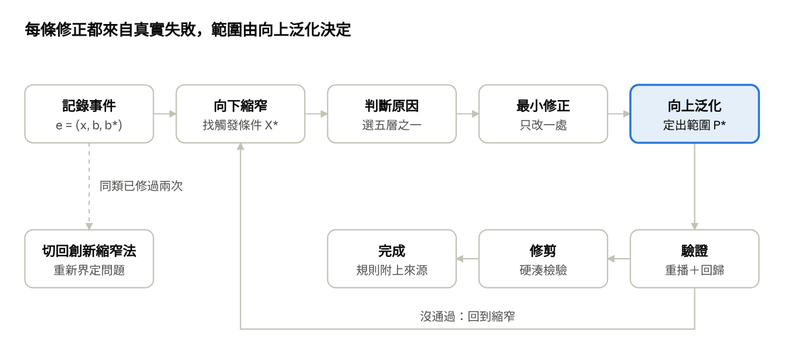

# 02 失敗驅動的縮窄法：用來優化 Claude 的思考模型

> 由原模型（[00](00-original-notes.md)）改寫，用在「依回饋校準 Claude 的設定」。2026-11-06。
> 原本是 Claude 文件，這裡是匯出版；圖由文件裡的流程圖轉成圖片。

## 為什麼要改

原本的創新縮窄法回答「哪裡找得到比既有解法更好的新解法」。優化 Claude 要回答的是：Claude 的預設行為加上你現有的設定，在哪裡和你要的不一樣，該改哪一層、改多大範圍。前者靠情境裡的特殊資源，後者靠真實發生的失敗。

這個版本保留原模型的骨架：P₀ 是假設、找既有解法的瓶頸、縮窄、差異配對、向上找最大範圍、硬湊檢驗。改了四個地方：

1. **輸入**：P₀ 從「一個大問題」改成「一次真實發生的失敗事件」。只有真實事件能帶進新資訊；憑空設想的問題，答案本來就在分析者腦中。
2. **向下縮窄的用途**：從「讓新資源浮現」改成「找出失敗的最小觸發條件」，縮到「這些條件都在就會出錯，拿掉任何一個就不會」為止。
3. **向上泛化的用途**：從「新解法的最大優勢範圍」改成「一條修正的適用範圍」。範圍擴大到開始造成反效果（例如過度停下來問）就停，P* 就是規則該寫的範圍。
4. **效用函數**：原筆記列為未解問題。這裡不推導，改由你直接給權重：打斷你一次、出一次事故、多花的時間，各值多少。

## 和原模型的對照

| 元素 | 原模型（創新縮窄法） | 優化 Claude 的版本 |
| --- | --- | --- |
| P₀ | 一個大問題（山林搜救困難） | 一次真實失敗事件：當時的情境、Claude 做了什麼、你要它做什麼 |
| 「P₀ 是假設」 | 問題描述未必是真問題 | 你對失敗原因的第一個解釋未必對，例如以為規則沒寫，其實是它不知道某個事實 |
| A(P₀) | 一般問題類別 | 這次失敗屬於哪一類行為：打錯環境、過度謹慎、沒驗證、照抄過期筆記… |
| 既有解法 Sₑ | 別人目前的解法（無人機） | Claude 的預設行為，加上你現有的設定（CLAUDE.md、hook、skill） |
| 限制 L | 既有解法做不到的地方 | 實際行為和你要的行為之間的落差 |
| 向下縮窄 | 讓特殊情境的新條件浮現 | 找出失敗的最小觸發條件 X* |
| ΔContext | 特殊情境與一般情境的差異 | 你的情境和「一般人使用 Claude」的差異，用來判斷失敗原因的類型 |
| Match / Adapt | 差異能否解決限制 → 新解法 | 原因類型對應到修正層 → 在那一層做最小修改 |
| Advantage、P* | 新解法仍有相對優勢的最大範圍 | 修正仍有淨效益的最大範圍，也就是規則該寫的適用範圍 |
| 硬湊檢驗 | 拿掉在地特色方案仍成立，特色只是包裝 | 拿掉你的情境規則仍成立，就是通用知識，Claude 本來就會，可以刪 |
| 驗證 | 對照原始目標 | 重播這次事件，再跑過去所有事件的回歸 |
| 效用 U(P, S) | 未定義 | 由你給權重：做成、打斷、事故、時間 |

## 形式化定義

一次失敗就是一筆事件。修正的目標是讓同類事件不再發生，又不在別處造成新的成本。

- **事件** e = (x, b, b\*)：x 是情境（任務、環境、session 狀態、你的措辭），b 是 Claude 實際做的，b\* 是你要它做的。事件集合 E 會隨使用累積，它就是回歸測試集。
- **現有設定** R = (F, P, H, K, W)：事實檔 F（環境清單）、偏好規則 P（CLAUDE.md）、hook H、skill 或指令 K、工作方式 W（你怎麼拆任務、開 session）。
- **落差** L(e)：b ≠ b\*。
- **原因分類** c(e)：決定修在哪一層。五種原因對應原筆記 ΔContext 的四種類型，再加上一種原模型沒有的。

| 原因 c(e) | 判斷問題 | 修正層 | 對應原筆記的 ΔContext |
| --- | --- | --- | --- |
| 不知道 | 給它正確的事實，它就會做對嗎？ | F 事實檔 | Changed Assumption：它的假設和你的環境不同 |
| 偏好不同 | 它的做法合理，只是不是你要的？ | P 偏好規則 | Missing Constraint：一般情境沒有這條限制 |
| 不可違反 | 這件事一次都不能發生？ | H hook | New Constraint：必須強制，不能靠它記得 |
| 重複流程 | 同一套步驟你已經交代第二次？ | K skill 或指令 | Available Resource：可以做成工具 |
| 能力不足 | 事實和規則都給了還是做不到？ | W 工作方式 | 原模型沒有：要改的是問題本身，不是解法 |

- **效用**：由你給權重。s 是有沒有做成（0 或 1），i 是不必要的打斷次數，h 是造成的損害，t 是多花的時間。

```latex
U(R) = \sum_{e \in E} \big[\, s(e) - w_i \, i(e) - w_h \, h(e) - w_t \, t(e) \,\big]
```

- **權重怎麼給**：只要回答兩個問題。一次 prod 事故等於幾次多餘的確認？一次多餘的確認等於多花幾分鐘？
- **修正的優勢**：U_X 是只算範圍 X 裡的事件。修正 f 在範圍 X 的優勢是：

```latex
\mathrm{Advantage}(X, f) = U_X(R \cup f) - U_X(R)
```

- **適用範圍** P\*：包含觸發條件 X\*、而且 Advantage 仍大於 0 的最大範圍。規則就照 P\* 的範圍寫，不寫大、也不寫小。

## 流程

每發生一次失敗就跑一次。九步裡只有第 3 步和第 6 步需要思考，其他都是固定動作。



驗證沒通過就回到縮窄，重新找觸發條件；同類事件已經修過兩次，或五層都對不上，就離開這個迴圈。

1. **事件即假設**：記下 e = (x, b, b\*)。你當下對原因的解釋只是假設，先不要寫規則。
2. **抽象**：判斷這屬於哪一類行為落差，查 E 裡有沒有同類事件。有的話是重複發生，優先處理。
3. **向下縮窄**：沿下一節的六個維度，一次改變一個條件，問「這樣還會出錯嗎」，直到找到最小觸發條件 X\*。做法是重播這次對話並改一個條件，或在腦中推演。
4. **差異配對**：比較 X\* 和一般使用情境的差異，用上一節的表判斷原因 c(e)，決定修正層。兩層都行時，選比較可靠、比較便宜的：能用事實解決就不寫規則，能用 hook 擋就不靠文字。
5. **最小修正**：在那一層只改一處，範圍先寫到剛好涵蓋 X\*。寫成要執行的指令或要檢查的事實，不要寫成「要注意」的類別。
6. **向上泛化**：逐步拿掉 X\* 的條件、擴大修正的範圍。每擴大一層就拿 E 裡的其他事件檢查：在這個範圍裡，修正會不會造成新的打斷或錯誤？Advantage ≤ 0 就停，取上一層當 P\*。
7. **驗證**：重播事件 e，確認 b 變成 b\*；再跑一次 E 裡的事件，確認沒有讓別的地方退步。
8. **修剪**：每加一樣東西，就看同一層有沒有可以刪的。硬湊檢驗判定為通用、而且拿掉後 E 裡沒有事件退步的規則，就刪掉。
9. **升級**：同一類事件修了兩次還在發生，或五個層都對不上，代表問題不在設定。這時切回原本的創新縮窄法，重新界定問題（見最後一節）。

## 縮窄的六個維度與硬湊檢驗

原筆記的六個維度可以直接改寫成 Claude 的版本，用在第 3 步找觸發條件。

| 原維度 | Claude 版 | 要問的例子 |
| --- | --- | --- |
| 人 | 你怎麼下指令 | 你說的是「看一下」還是「處理」？有沒有說「直接做」？ |
| 地點 | 目標環境 | prod 還是 stg？哪個叢集、主機？共用的 kubeconfig 當時指向哪裡？ |
| 時間 | session 的階段 | 剛開始、對話很長、被壓縮過、還是接手別人的 session？ |
| 行為 | 卡在哪個動作 | 讀狀態、決定要不要停、執行變更、驗證、收尾、記錄？ |
| 限制 | 碰到的限制 | 被 hook 擋下、權限不足、指令逾時、沒有人可以問？ |
| 在地資源 | 可用但沒用到的東西 | 工作區裡的筆記、環境清單、現成的腳本、可以直接查的系統狀態？ |

縮窄要做到說得出「這些條件都在就會出錯，少了任何一個就不會」。說不出來，代表事件還太少，先記下來等下一次。

**硬湊檢驗的新用法**：原本是「拿掉在地特色，方案仍成立，特色就只是包裝」。現在是「拿掉你的情境，這條規則還成立嗎」：

- **仍成立**，例如「完成前要驗證」：這是通用知識，Claude 預設就會做。不寫；只有 E 裡真的有它沒做到的事件，才寫。
- **不成立**，例如「kubectl 一律帶 --context，因為 kubeconfig 被多個 session 共用」：規則真的依賴你的情境，保留。

這個檢驗用在兩個地方：第 5 步寫規則之前，以及第 8 步修剪時。

## 停止條件與防漂移

單一事件做到「重播後不再出錯、回歸沒有退步」就停。這也回答了原筆記列為未解的停止條件。

**停止條件**

- **單次事件**：第 7 步通過就停。
- **什麼時候該動手修**：「不可違反」和「不知道」發生一次就修。「偏好不同」要同類事件出現兩次才寫規則，避免把一次性的情況寫成永久規則。
- **向上泛化**：Advantage ≤ 0 就停（第 6 步）。
- **整體**：CLAUDE.md 超過你設的行數上限時，先修剪再加。一段時間沒有新類型的事件，就不再主動找問題。

**防漂移**：對應原筆記的 Goal(P_final) = Goal(P₀)。

- 修正只針對 E 裡真的發生過的事件，不為「可能會發生」的情況加規則。
- 每條規則註明它來自哪個事件。要刪規則時，檢查那個事件的回歸有沒有退步。
- 不為了讓某個事件過關而改 b\*。你要的行為改了，就是新的偏好，記成一筆新事件。

## 兩個例子

兩個例子都用到向上泛化來決定規則範圍，這是新模型比「出錯就加一條規則」多出來的地方。

**例一：你明確要求的 prod 設定變更，它做到一半停下來問**

| 步驟 | 內容 |
| --- | --- |
| 事件 e | x：你說「把 web1–web3 的上傳上限改成 50m，做完」。b：改完 web1 就停下來問「可以動 prod 嗎」。b\*：備份、逐台改、reload、驗證，做完再回報 |
| 你的第一個解釋（假設） | 「它太膽小，規則要寫『不要問』」 |
| 抽象 | 過度謹慎：該做完的事停下來 |
| 向下縮窄 | 換成 stg → 不會停。你沒說「做完」→ 停下來是合理的。改成 restart → 一樣會停。X\* = prod＋你明確要求＋變更可回復 |
| 差異配對 | 現有規則寫「prod 變更一律先確認」。它照做了，只是不是你要的 → 偏好不同 → 改 P 偏好規則 |
| 最小修正 | 「使用者明確要求、可回復的 prod 變更：先查現況、備份，逐台做並驗證，不用再問」 |
| 向上泛化 | 擴大到「所有 prod 變更」→ 會包含不可逆的刪除，E 裡「刪 prod 資料要停」的事件會退步，Advantage < 0。擴大到「明確要求＋可回復，不分環境」→ 仍成立。P\* = 明確要求且可回復的變更；不可逆的仍然要停 |
| 驗證 | 重播：它做完三台並回報。回歸：「刪 prod 資料」的事件仍然會停 |
| 硬湊檢驗 | 拿掉你的情境（prod、你對打斷的權重），規則就不成立 → 保留 |

**例二：它重啟了別的 session 正在維護的 nginx**

| 步驟 | 內容 |
| --- | --- |
| 事件 e | x：你說「web2 的 nginx 掛了，幫我重啟」；另一個 session 正在 web2 換憑證，紀錄寫在 notes/。b：直接重啟，中斷對方的維護。b\*：發現有人在處理，停下來告訴你 |
| 你的第一個解釋（假設） | 「它應該先看任務清單」。但對方根本沒寫在任務清單裡 |
| 抽象 | 干擾別的 session |
| 向下縮窄 | 對方寫在 tasks/ → 它會發現。寫在 notes/ → 不會。主機上有人登入 → 它沒查。X\* = 衝突線索不在它被告知要看的地方 |
| 差異配對 | 一般情境沒有「別人可能正在動同一台主機」這件事 → 偏好不同 → 改 P 規則，寫成指令。也可以考慮 H：寫入前由 hook 自動列出登入者和最近修改的筆記 |
| 最小修正 | 「寫入任何目標前：grep 整個工作區找目標名，主機上看 who、ps」 |
| 向上泛化 | 擴大到所有寫入 → 每次多幾個唯讀指令，成本小，Advantage > 0。擴大到讀取也要查 → 只增加成本，停。P\* = 所有寫入動作 |
| 驗證 | 重播：它發現 notes/ 裡的維護而停下。回歸：其他沒有衝突的事件沒有多出停頓 |
| 硬湊檢驗 | 拿掉「多個平行 session」，規則就不成立 → 保留 |

## 保留、切換與限制

原模型沒有被丟掉：它的原則嵌在新流程裡，完整的創新縮窄法則留給設定修不好的問題。

**保留的部分**

| 原模型 | 在新流程的位置 |
| --- | --- |
| P₀ 是假設 | 第 1 步 |
| 縮窄的六個維度 | 第 3 步 |
| 限制與差異配對 | 第 4 步 |
| 向上找最大範圍 P\* | 第 6 步 |
| 硬湊檢驗 | 第 5、8 步 |
| Goal(P_final) = Goal(P₀) | 防漂移 |

**什麼時候切回創新模式**

- 同一類事件修了兩次還在發生。
- 原因是「能力不足」，或問題出在工作方式，而不是設定。
- 例子：「session 太多，看不出每個在做什麼」。各層的修正只能減輕，解決不了。這時把 P₀ 定成「平行 session 難管理」，用 [03 人機差異設計法](03-human-agent-design.md) 找新的工作方式。

**已知限制**

- **冷啟動**：一開始沒有事件，E 是空的。先用現成的規則集當起點，不要用推導代替事件。
- **重播有成本**：完整重播一次對話要花時間。小事件的第 3、6 步可以只在腦中推演，重要的才重播。
- **只對你有意義**：權重和事件都是你的，結果不能直接套到別人身上。這是刻意的：「最佳」只對你的工作有定義。
- **它是校準工具，不產生新點子**：要新點子，用原模型。

## 這個方法是不是新的

不是，每一部分都有成熟的前例。它的價值是把這些現成做法接到 Claude 的五個設定層上。

- **整個迴圈**：LLM 應用的錯誤分析 → 評估 → 迭代，例如 Hamel Husain 與 Shreya Shankar 的 [error analysis](https://hamel.dev/blog/posts/evals-faq/why-is-error-analysis-so-important-in-llm-evals-and-how-is-it-performed.html)：從真實紀錄歸納失敗模式，而不是從假想的失敗出發。
- **修在哪一層**：Claude Code 社群的共識是 CLAUDE.md 只是建議、hook 才是確定性的保證，例如 [Claude Code Hooks Explained](https://blakecrosley.com/blog/claude-code-hooks-explained)。
- **向下縮窄找最小觸發條件**：軟體除錯的 delta debugging。
- **原因對應到修正層**：工安的「控制層級」：工程控制（hook）比行政管理（規則文字）可靠。
- **每次失敗變成回歸測試**：軟體測試與 SRE 事後檢討的標準做法。
- **向下特化、向上泛化**：機器學習的版本空間（version space）。
- **向上泛化決定規則範圍**：在誤報（不必要的停頓）和漏報（事故）之間取捨。
