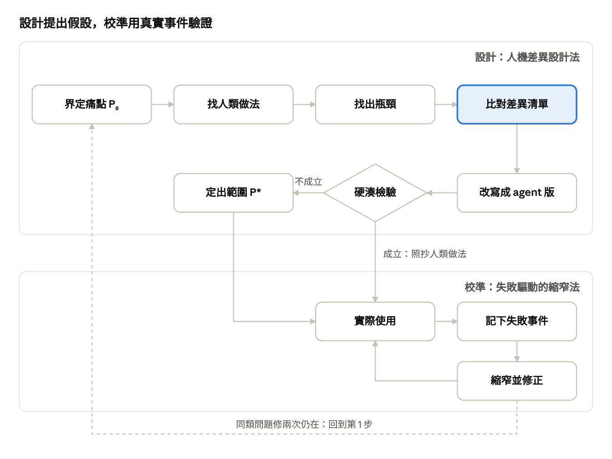

# 03 人機差異設計法：用來設計 agent 工作流的思考模型

> 由原模型（[00](00-original-notes.md)）改寫，用在「創造」新的 agent 工作方式。2026-11-06。
> 原本是 Claude 文件，這裡是匯出版；圖由文件裡的流程圖轉成圖片。

把原模型的「一般解法」換成人類團隊的工作方法，「情境差異」換成「工作者從人變成 agent」，就得到一個專門設計 agent 工作流的模型。它負責「創造」新的工作方式，驗證交給 [02 失敗驅動的縮窄法](02-failure-driven-narrowing.md)。

## 核心想法

這次對得上，是因為「工作者從人變成 agent」這個差異裡有大量資源，而資源型的差異正是原模型最擅長的。

拿原模型去調 CLAUDE.md 效果不好，是因為那裡的差異大多是限制：prod、不可逆、共用狀態，推出來的只是常見的安全規則。設計工作流則不同，比較的對象是「人類團隊怎麼做」：

- **資源很多**：開新 session 幾乎不花錢、可以平行、可以重跑、照文字一字不差地執行。很多人類方法的瓶頸（人力、時間、疲勞）因此消失。
- **差異清單可以重複使用**：人和 agent 的差異幾乎不隨問題改變，整理一次就能一直用，每次套用的成本很低。
- **硬湊檢驗有新用途**：它能分出「直接照抄人類做法就好」和「真的需要為 agent 重新設計」的部分，把力氣花在後者。

這個模型只負責提出新的工作方式（假設），不負責證明它有效。證明要靠真實使用中的事件，交給失敗驅動的縮窄法。

## 和原模型的對照

骨架完全沿用，只是「一般問題」固定成「如果是人類團隊會怎麼做」。

| 元素 | 原模型（創新縮窄法） | 人機差異設計法 |
| --- | --- | --- |
| P₀ | 一個大問題 | 一個工作流痛點，例如 session 太多難管、接手常出錯、prod 變更太慢 |
| A(P₀) | 一般問題類別 | 「如果做這件事的是一個人類團隊，會怎麼組織？」 |
| 既有解法 Sₑ | 別人目前的解法 | 人類團隊的工作方法：看板、工單、code review、交接單、鎖、值班、runbook、事故指揮 |
| 限制 L | 既有解法做不到的地方 | 這些方法在人類團隊裡的瓶頸：人力、時間、溝通成本、疲勞 |
| 縮窄 | 地點、人、時間…六個維度 | 任務類型、風險、時長、平行程度、有沒有人在場、狀態存在哪裡 |
| ΔContext | 特殊情境的差異 | 工作者從人變成 agent 的差異，是固定清單（見下一節） |
| Match | 差異能否解決限制 | 某個差異能不能消除人類方法的瓶頸，或讓它失效 |
| Adapt → Sₙ | 新解法 | 為 agent 改寫的工作方法 |
| Advantage、P\* | 新解法仍有優勢的最大範圍 | 改寫後的方法在哪些任務範圍仍然划算 |
| 硬湊檢驗 | 拿掉在地特色，方案仍成立嗎 | 把工作者換回人類，方法還原封不動成立嗎？成立就是通用好做法，照抄即可；不成立才是真正的 agent 設計 |
| 驗證 | 對照原始目標 | 交給失敗驅動的縮窄法，用真實事件驗證 |

## 人與 agent 的差異清單

差異分兩類：資源是 agent 做起來很便宜、人做不到的事，用來消除人類方法的瓶頸；限制是 agent 比人弱的地方，要加上補償機制。每次套用時逐條比對。

| 差異 | 類型 | 對工作流的意涵 |
| --- | --- | --- |
| 開新工作者幾乎不花成本 | 資源 | 可以平行嘗試多個做法、用完即丟；「人力不足」不再是瓶頸 |
| 同一個任務可以重跑 | 資源 | 失敗可以重播，事件能變成測試 |
| 不嫌重複、不會累 | 資源 | 每一步都寫紀錄、每次都跑驗證，成本很低 |
| 能被程式確定性地約束（hook、權限） | 資源 | 不可違反的事交給機制，不必靠訓練或提醒 |
| 照文字一字不差地執行 | 資源也是限制 | runbook 可以直接執行；但過期的 runbook 也會被一字不差地執行 |
| 跨 session 不記得，長對話會被壓縮 | 限制 | 狀態必須寫在檔案或系統裡，交接要寫成檔案 |
| 看不到其他 session | 限制 | 協調不能靠「大家都知道」，要有明確的鎖或宣告 |
| 遵守規則是機率性的 | 限制 | 關鍵的事不能只寫成文字 |
| 會自信地出錯，同一個模型的錯誤彼此相關 | 限制 | 審查要換脈絡（另一個 session、不同的資料），不能自己審自己 |
| 不知道環境的隱性事實 | 限制 | 需要事實檔，並在動手前查即時狀態 |
| 你的注意力成為唯一的稀缺資源 | 結構變化 | 瓶頸從「工作者的時間」移到「你的核准與閱讀」，很多人類方法的重點要跟著搬家 |

這份清單會隨模型能力改變。例如模型有了可靠的長期記憶，「跨 session 不記得」這一條就要重寫。換模型世代時，先重新檢查這張表。

## 流程

設計迴圈負責提出新的工作方式，校準迴圈負責在真實使用中驗證和修正。兩者接在一起，才同時有新點子和證據。

硬湊檢驗成立的做法直接照抄，不成立的才需要定範圍；使用中同一類問題修了兩次還在，就回到設計。

1. **界定 P₀**：把工作流的痛點寫成一句話，當成假設，不是事實。
2. **找人類版本**：如果做這件事的是人類團隊，他們會用哪些方法？列出 2 到 4 個。
3. **找瓶頸**：每個人類方法在人類團隊裡卡在哪裡？
4. **逐條比對差異清單**：哪個差異會消除這個瓶頸（資源）？哪個會讓方法失效（限制）？
5. **改寫**：用資源放大方法，對限制加上補償，寫成 agent 版本的工作方法。
6. **硬湊檢驗**：把工作者換回人類，改寫後的方法還原封不動成立嗎？成立就直接照抄人類做法，不必再設計；不成立才是真正的 agent 設計，值得投入。
7. **向下縮窄、向上泛化**：先找出新方法最划算的任務範圍，再擴大到開始不划算為止，得到 P\*。
8. **交給校準**：開始實際使用，出錯時用失敗驅動的縮窄法修正。同一類問題修了兩次還在，就回到第 1 步重新設計。

## 實例：平行 session 難管理

四個人類方法裡，有兩個在換成 agent 後重點完全搬家，這兩個是真正的新設計。

P₀：「同時開很多 session，看不出每個在做什麼，也會互相踩到。」

| 人類方法 | 人類版的瓶頸 | 相關的 agent 差異 | agent 版本 | 硬湊檢驗 |
| --- | --- | --- | --- | --- |
| 看板加上進行中數量上限 | 限制工作者同時做的事，避免切換成本 | agent 沒有切換成本；你的注意力是唯一的稀缺資源 | 限制的是「等你處理的項目」（等核准、等回答、等你看結果），不是執行中的 session 數。超過上限就不再開新任務 | 不成立：人類要限制的是工作者 → 新設計 |
| 工單加上負責人 | 寫工單麻煩，常被省略 | agent 不嫌麻煩，但會遺忘 | 每個 session 一開始就建工單、達到里程碑就更新，session 名稱以工單編號開頭。工單就是 session 的外部記憶 | 大致成立：人類也該這樣做 → 照抄，再用機制強制 |
| 資源鎖 | 人靠口頭協調，鎖常忘了釋放 | agent 看不到彼此、會忘記釋放；可以被 hook 約束 | 帶到期時間的租約，寫在共用位置；寫入前由 hook 自動檢查，過期自動失效 | 部分成立：人類也能用，但不必要 → 偏向新設計 |
| 每日站會 | 佔用全員時間 | 彙整很便宜；你的注意力是瓶頸 | 一個「總覽 session」定時讀所有工單，只把需要你決定的事列給你 | 不成立：人類站會的價值在溝通 → 新設計 |

**適用範圍**：第一個方法只在同時進行的 session 多到你開始漏看結果時才划算，只有一兩個 session 時是多餘的。第四個只在有多個長時間任務並行時划算。

**和現有工具的關係**：ops-context-kit 已經做了第二個（tasks/ 加 session 改名）和第四個的一部分（任務總覽）。第一個的「等你處理」上限、第三個的到期租約，是這個模型新推出來的。

## 已有的相近做法與限制

「把人類團隊的做法搬給 agent」早就有人做。這個模型的差別在於用差異清單和硬湊檢驗決定哪些照抄、哪些重新設計。

**已有的做法**

- [MetaGPT](https://arxiv.org/html/2308.00352v6)：把人類軟體團隊的標準作業程序（SOP）寫成 prompt，定義產品經理、架構師、專案經理、工程師、QA 五個角色，依序傳遞文件。它是「照抄人類組織」的代表，沒有問哪些部分在 agent 身上已經不必要。
- [Anthropic〈Building effective agents〉](https://www.anthropic.com/research/building-effective-agents)：整理了 prompt chaining、routing、parallelization、orchestrator-workers、evaluator-optimizer 等模式。其中不少正是資源型差異的產物：開新工作者便宜，所以有平行與投票；審查要換脈絡，所以有獨立的評估者。這個模型可以看成「產生這類模式的方法」，而不是另一套模式。

**這個模型多出來的**

- 每個設計都有「是哪個差異造成的」這個理由。換模型世代時，知道該重審哪些設計。
- 硬湊檢驗避免把人類組織原封不動搬過來，例如讓 agent 開站會。
- 「你的注意力是唯一的稀缺資源」這個結構變化常被忽略，很多人類方法都要改成以它為中心。

**限制**

- 它是點子產生器，不是驗證器。每個設計都要靠真實使用驗證。
- 重新詮釋的那一跳仍然靠人：方法帶你看到差異，不保證你看出用法。
- 差異清單會隨模型能力過時，要定期重審。
- 沒有使用資料時，適用範圍（P\*）只能估計。

Sources: [MetaGPT（arXiv）](https://arxiv.org/html/2308.00352v6) · [Building effective agents（Anthropic）](https://www.anthropic.com/research/building-effective-agents)
